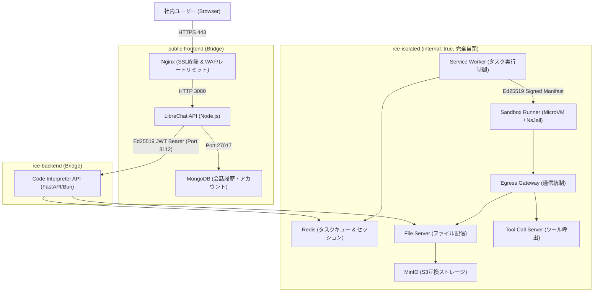

# Architecture & Security Design / アーキテクチャ・セキュリティ設計

## 1. 3層完全分離ネットワークアーキテクチャ

本スタックは、外部通信を必要とする Web 層と、任意コード実行（RCE）を担うサンドボックス実行層をネットワークレベルで厳格に分離しています。

### ネットワーク層の役割
1. **`public-frontend`**: 社内 LAN からのインバウンド HTTPS 通信を受け付けます。Nginx、LibreChat API、MongoDB のみが所属します。
2. **`rce-backend`**: LibreChat API と CodeAPI 間の通信ブリッジです。コード実行リクエストのみが中継されます。
3. **`rce-isolated` (`internal: true`)**: Docker の `internal: true` オプションにより、ホスト外およびインターネットへのルーティングが完全に遮断された自閉ネットワークです。外部からの侵入・外部へのデータ流出が防止されます。

---

## 2. ゼロトラスト認証 (Ed25519 JWT & Manifest 署名)

### 2.1 `LOCAL_MODE=true` の完全排除
従来のセットアップでは内部通信の簡易化のために `LOCAL_MODE=true`（認証スキップ）が使用されていましたが、本スタックではこれを完全に排除し、`CODEAPI_AUTH_PROVIDER=librechat-jwt` を採用しています。

### 2.2 鍵ペアの責務分離
- **JWT 署名鍵 (Ed25519 / EdDSA)**:
  - **秘密鍵 (JWK)**: LibreChat API コンテナのみが保持。ユーザーごとの短命トークン（TTL 300秒）をリクエスト毎に署名。
  - **公開鍵 (JWKS)**: CodeAPI コンテナのみが保持。リクエストの署名・テナントID・ユーザーIDを暗号論的に検証。
- **実行マニフェスト署名鍵 (Ed25519)**:
  - **秘密鍵**: `service-worker` のみが保持。実行パラメータ（メモリ制限・実行時間・Egress 許可）を署名。
  - **公開鍵**: `sandbox-runner` のみが保持。署名が一致しない実行リクエストは Sandbox レベルで拒否。
